# Telegram Shop Bot

A ready-to-run Telegram shop: customers browse a catalog, fill a cart and check out inside the chat, and the shop owner manages orders, products, stats and announcements from the same chat. English and Russian are built in.

> **Portfolio project.** This is a demonstration build with a small fictional catalog ("Maple & Pine Goods"). It has not been used by real customers and makes no claims about sales or users. It has been verified with an automated test suite; a run against the live Telegram service has not been done yet (see [Live demo screenshots](#live-demo-screenshots)).

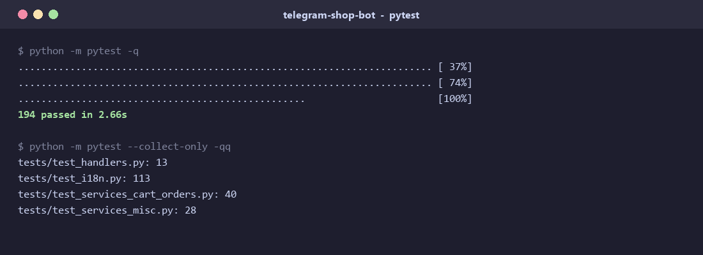

*Real output of `python -m pytest -q` (309 tests, no network, no bot token needed). Regenerate with `python -m scripts.make_test_image`.*

---

## What it does (for the shop owner)

**Your customers** open the bot and tap through a menu: pick a category or search by product or category name (also in Russian), see product cards with price and description (and a photo, if you add one), add items to a cart, change quantities, and check out by entering name, phone and delivery address, then choosing cash on delivery, card on delivery or a bank transfer. For a bank transfer the bot shows your bank details and the amount, and the customer sends a photo or PDF of the payment receipt. They get an order confirmation, and a message every time you change the order status.

**You (the admin)** get every new order in your own Telegram chat, with the customer's receipt attached when they paid by transfer, and buttons to move it from New to Confirmed, Shipped, Delivered or Cancelled. The bot only offers steps that make sense (a delivered order cannot be cancelled by mistake). You can also list orders by status, switch products on or off, add, edit and delete products (the photo can be uploaded right in the chat), add, rename and delete categories, see today's and the last 7 days' orders and revenue, and send an announcement to everyone who started the bot, with a preview and confirmation first.

### Feature list

| Area | Included |
|---|---|
| Customer menu | `/start` main menu with inline buttons, help, "My orders" |
| Catalog | Categories, product cards (name, price, description, one optional image: an uploaded photo or a URL) |
| Search | `/search` or the Search button: finds in-stock products by name or category name, any letter case, Cyrillic included; says so when nothing matches |
| Cart | Add, remove, change quantity, running total, clear |
| Checkout | Step-by-step form (name, phone, address, payment), summary and confirmation; cash or card on delivery, or bank transfer with a receipt upload (photo or PDF), see below |
| Notifications | New orders pushed to all admins (with the receipt as the photo or document, the order summary as its caption and the status buttons below it); customers notified on every status change |
| Order workflow | `new -> confirmed -> shipped -> delivered`, cancel allowed until delivered; invalid jumps are refused |
| Admin tools | `/orders` (filter by status, open a receipt), `/products` (on/off toggle, delete), `/add_product`, `/edit_product`, `/categories` (add, rename, delete empty ones), `/stats`, `/broadcast` |
| Broadcast | Preview and confirm step, throttled to stay under Telegram's limits, honours flood-control replies, remembers users who blocked the bot |
| Languages | English and Russian, picked from the user's Telegram language, `/language` to switch |
| Robustness | Unknown text, commands, stale buttons and invalid form input get friendly replies; errors are logged, never crash polling |
| Storage | SQLite (single file), money stored in integer cents; columns added in newer versions are added to an existing database on startup |

### Not included (by design, see [How to extend](#how-to-extend))
Online card payments, stock counts, discounts, multiple shops, a web dashboard. Bank receipts are only collected and forwarded: the bot cannot tell whether a receipt is genuine or the amount matches, the admin checks it and confirms the order. A receipt cannot be added to an order after it is placed. FSM state is kept in memory, so a half-finished checkout is lost if the bot restarts (the cart and orders are safe in the database).

---

## Quick start (3 steps)

You need Python 3.11+ (developed on 3.12).

1. **Get a token.** In Telegram open [@BotFather](https://t.me/BotFather), send `/newbot`, follow the prompts, copy the token. To find your own numeric Telegram id, message [@userinfobot](https://t.me/userinfobot).
2. **Configure.** Copy `.env.example` to `.env` (`copy .env.example .env` on Windows, `cp .env.example .env` elsewhere) and set `BOT_TOKEN` and `ADMIN_IDS` (your id).
3. **Run.**
   ```
   python run.py
   ```
   That one command creates a virtual environment, installs dependencies, loads the demo catalog on first start and launches the bot. Open your bot in Telegram and send `/start`.

**With Docker** (instead of step 3): `docker compose up -d --build`. The database is kept in `./data`.

> The Dockerfile and compose file were written but **not built or run** on the machine this project was developed on (the Docker daemon was not running). They are short and standard, but treat them as untested until you try them.

Admins must press Start in the bot once, otherwise Telegram will not let the bot message them.

---

## Admin guide

Admins are the Telegram ids in `ADMIN_IDS` (comma-separated). Everyone else is a customer; admin commands answer them with "no permission". Admins see an extended command menu in Telegram.

| Command | What it does |
|---|---|
| New-order message | Arrives automatically. Tap a status button to move the order forward; the customer is notified. Buttons shown are only the allowed next steps. |
| `/orders` | Pick a status filter (or `/orders shipped`, `/orders all`), tap an order to open it and change its status. Shows the latest 10 per filter. |
| Receipt button | On an order opened from `/orders` (or under a new-order message) that has a receipt, tap Receipt to get the photo or PDF again. |
| `/products` | Lists all products. Tap a product name to show or hide it in the shop (that is the availability switch); tap Edit to change it; tap the bin to delete it (asks first; past orders keep their lines). |
| `/add_product` | Choose a category, then send name, price (`12.50`), description and a photo or an image URL (or `-` to skip), then confirm. |
| `/edit_product` | Pick a product and a field (name, price, description, image, category) and send the new value. Existing orders keep the old price. |
| `/categories` | Lists categories. Tap one to rename it (send the English and the Russian name, `-` keeps the current one), the bin deletes it, Add category creates one. A category that still has products cannot be deleted: move or delete the products first. |
| `/stats` | Orders and revenue for today and for the last 7 days (cancelled orders excluded). "Today" follows `TIMEZONE`. |
| `/broadcast` | Send a message, review the preview, confirm. You get a report: sent, blocked, failed. |
| `/cancel` | Abort any multi-step form. |

Order statuses: `new` can become `confirmed` or `cancelled`; `confirmed` can become `shipped` or `cancelled`; `shipped` can become `delivered` or `cancelled`; `delivered` and `cancelled` are final.

### Bank transfer and receipts

If `PAYMENT_DETAILS` is set, the payment step offers a third option, Bank transfer. The customer then sees your bank details and the amount to pay, and must send a photo or a PDF of the receipt (an image sent as a file is accepted too; other file types, text and stickers are answered with a reminder). The receipt's Telegram `file_id` and kind are stored on the order, and the new-order message to the admins is the receipt itself with the order summary as the caption and the status buttons under it. If the summary is too long for a Telegram caption (1024 characters) it is sent as a normal message with the buttons and the receipt follows right under it.

The step is mandatory for bank transfer orders: an order without proof of payment would make the option pointless, and the service layer refuses to create one. Customers who do not want to upload anything choose cash or card on delivery instead, or `/cancel` (the cart is kept). If `PAYMENT_DETAILS` is empty the option is hidden and checkout works as before.

### Google Sheets (optional)

Off by default; without the settings below the bot behaves exactly as before and never touches Google. When on, one spreadsheet does three jobs:

- **Orders go to the sheet.** Every confirmed order is appended as a row to the `Orders` tab. The order is saved in the database first; the sheet write runs in the background, is retried (after 2, 10 and 30 seconds) and, if it still fails, is logged and skipped. Checkout is never slowed down or broken by Google.
- **The menu comes from the sheet.** Edit prices, descriptions, photos and availability in the `Menu` tab, no developer needed. The bot reads the tab every `SHEETS_SYNC_SECONDS`.
- **Statuses can be changed in the sheet.** Type a new status into the `Status` cell of an order row; the bot applies it and messages the customer exactly as if you had pressed the button in Telegram. Buttons pressed in Telegram update the cell too.

**Setup, 5 steps**

1. In the [Google Cloud console](https://console.cloud.google.com/) create a project and enable the **Google Sheets API** for it.
2. Create a **service account** (IAM and admin, Service accounts), then Keys, Add key, JSON. Save the file next to the bot, e.g. `service-account.json`, and keep it private (it is a password).
3. Create a Google Sheet and **share it with the service account's email** (`...@...iam.gserviceaccount.com`) as **Editor**. The bot creates the `Orders` and `Menu` tabs by itself if they are missing.
4. Copy the sheet id from its URL: `docs.google.com/spreadsheets/d/<ID>/edit`.
5. Set `GOOGLE_SHEET_ID=<ID>` and `GOOGLE_SERVICE_ACCOUNT_FILE=service-account.json` in `.env` and restart the bot. The log shows `sheets: syncing every 60s`.

**Orders tab** (written by the bot, one row per order):

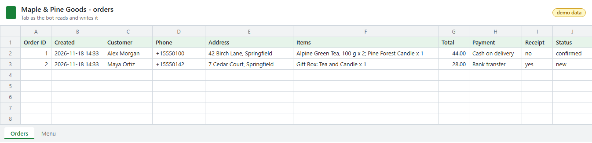

| Column | Content |
|---|---|
| Order ID, Created | Order number; time in the shop `TIMEZONE` |
| Customer, Phone, Address | As entered at checkout |
| Items, Total, Payment, Receipt | `Name x qty; ...`, order total as a number, payment method, `yes`/`no` for an attached bank receipt |
| Status | `new`, `confirmed`, `shipped`, `delivered` or `cancelled` (case does not matter) |

Only the Status column is read back. A value that is not a status, or a move the bot does not allow (for example `new` to `delivered`, or anything after `delivered` / `cancelled`), is ignored, logged, and the cell is reset to the real status. Sorting and filtering are fine, but keep column A intact: the bot finds an order's row by its Order ID.

**Menu tab** (read by the bot, one row per product):

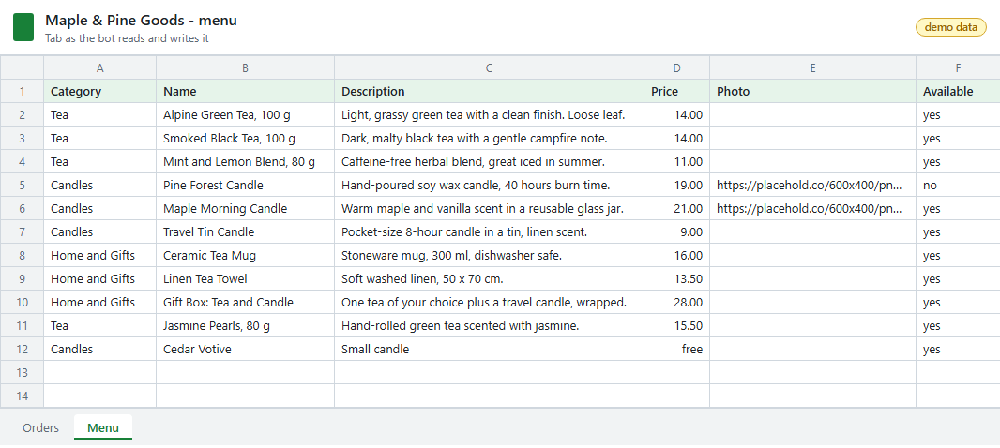

| Column | Content |
|---|---|
| Category | Matched against the English or Russian category name; an unknown name creates a new category |
| Name | Products are matched by name (case-insensitive), so renaming in the sheet creates a new product |
| Description | Text shown on the product card |
| Price | `12.5` or `12,50`, above zero |
| Photo | Image URL or a Telegram `file_id`. Empty keeps the current photo |
| Available | `yes` / `no` (also `да` / `нет`); empty means yes |

If the tab is new or empty, the bot first fills it with the current catalog, so you start from your real products. After that the sheet is the source of truth: a row with a bad price, an empty name or an unreadable Available value is skipped and logged (`Menu row 12: bad price 'free'`), the rest still applies. Products that are not listed any more are hidden, not deleted, so old orders keep their names and prices. If no row in the tab is valid, nothing changes. Set `SHEETS_MENU_SYNC=false` to keep only the Orders tab.

**Honest notes**

- Changes made in the sheet reach the bot within `SHEETS_SYNC_SECONDS` (default 60, minimum 10), not instantly. Each pass makes about two reads; Google's default quota is 60 read requests per minute per user, so keep the interval at 30 seconds or more for a busy shop.
- If Google is unreachable the bot keeps working. Order rows that could not be written after the retries are not queued for later; the order itself is safe in the database (and in the admin chat).
- Orders placed before you turn the feature on are not copied to the sheet.
- The bot owns the Orders columns A to J and the Menu columns A to F; put your own notes in columns to the right.
- Verified with an in-memory sheet and a stubbed gspread client; a run against a real spreadsheet has not been done yet.

### Settings

Set in `.env` (copy `.env.example`):

| Setting | Default | Meaning |
|---|---|---|
| `BOT_TOKEN` | (required) | Token from @BotFather |
| `ADMIN_IDS` | (empty) | Comma-separated Telegram ids of the admins |
| `DB_PATH` | `data/shop.db` | SQLite file |
| `SHOP_NAME` | `Maple & Pine Goods` | Name in the welcome message |
| `CURRENCY_SYMBOL` | `$` | Shown next to prices |
| `TIMEZONE` | `UTC` | IANA name, decides what "today" means in `/stats` |
| `PAYMENT_DETAILS` | (empty) | Bank details shown for bank transfer, `\n` for a line break. Empty hides the option |
| `LOG_LEVEL` | `INFO` | Python logging level |
| `BROADCAST_RATE` | `20` | Broadcast messages per second, capped at 30 |
| `GOOGLE_SHEET_ID` | (empty) | Id of the Google Sheet for the optional integration, see above |
| `GOOGLE_SERVICE_ACCOUNT_FILE` | (empty) | Path to the service account JSON key. Both settings must be set to turn Sheets on |
| `SHEETS_SYNC_SECONDS` | `60` | How often the Menu and Orders tabs are read (minimum 10) |
| `SHEETS_MENU_SYNC` | `true` | `false` stops reading the Menu tab (orders are still written) |

Product names and descriptions are entered in one language by the admin; category names (both languages) and all bot texts are bilingual.

Upgrading an existing `shop.db`: on startup the bot adds columns that newer versions need (the receipt columns on `orders`) and leaves all data alone. This only covers new optional columns; for anything bigger use a migration tool such as Alembic.

To replace the demo catalog: edit `scripts/seed.py` and run `python -m scripts.seed --force` (this wipes products and categories, keeps orders and users), or delete `data/shop.db` and start again.

---

## Live demo screenshots

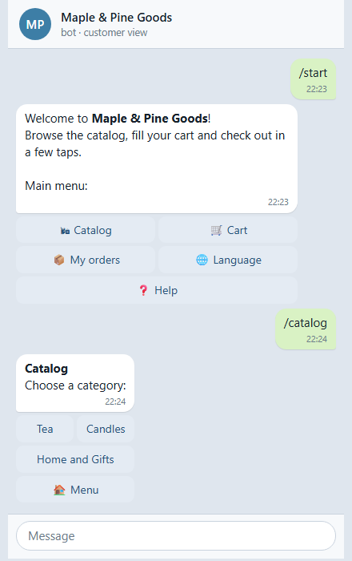

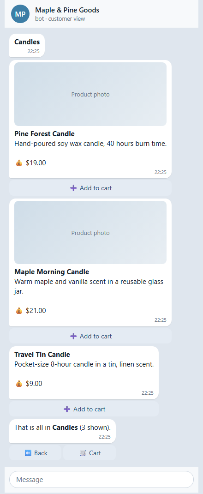

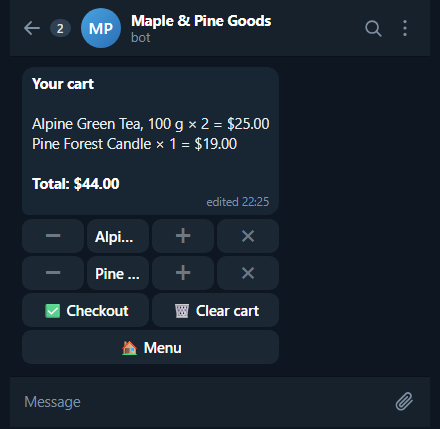

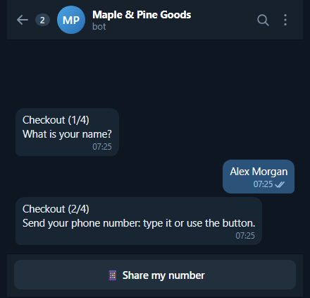

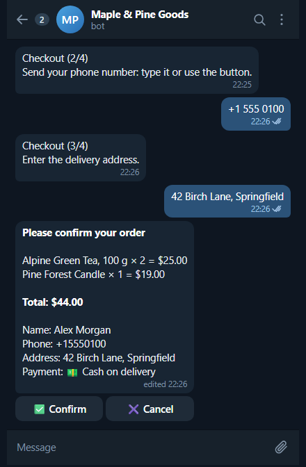

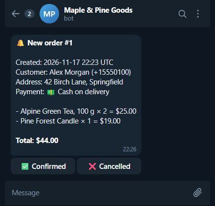

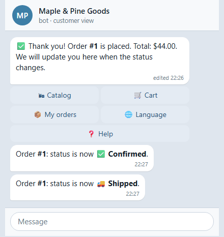

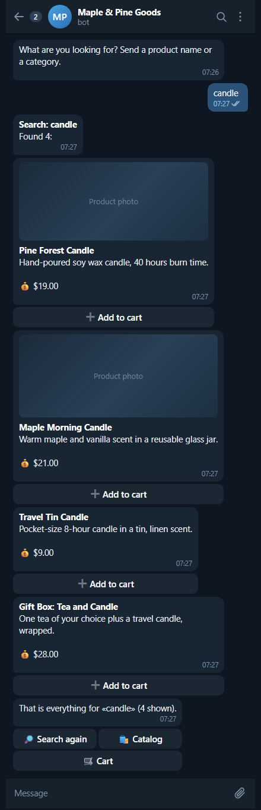

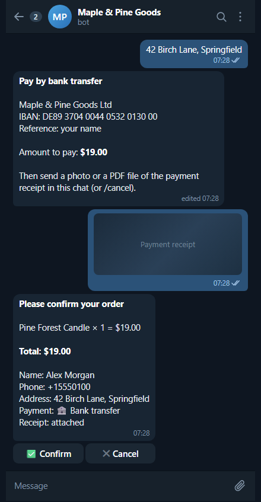

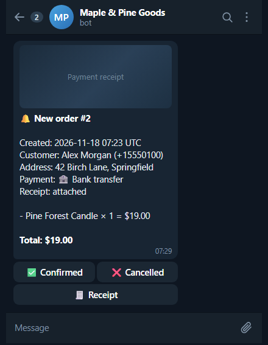

*Conversation rendered from the bot's real responses, captured by running the actual handlers with a recording Telegram session (`python -m scripts.capture_demo && python -m scripts.render_demo --screenshots`; the two spreadsheet images come from `python -m scripts.render_sheets`). Styled after a dark chat theme; not a screenshot of the Telegram app. Each image is the chat state at one moment, with message edits applied in place; product and receipt photos are placeholders. A run against the live Telegram service has not been done yet.*

---

## For developers

### Stack
Python 3.12, [aiogram 3](https://docs.aiogram.dev/) (polling, FSM, typed callback data), SQLAlchemy 2 async with aiosqlite, pydantic-settings, gspread (only used when Google Sheets is configured), pytest + pytest-asyncio.

### Architecture

```
app/
  main.py, bot.py        entry point; dispatcher + error handler + command menus
  config.py              Settings from .env
  middlewares.py         one DB session per update, user upsert, language injection
  handlers/              Telegram layer only: parse input, call services, render
    start, catalog, search, cart, checkout, admin_orders, admin_products,
    admin_categories, admin_misc, fallback
  keyboards/             inline keyboard builders (customer, admin)
  callbacks.py, states.py  typed callback data, FSM state groups
  services/              business logic, no Telegram objects except broadcast
    cart, catalog (search, guarded deletes), orders (checkout + status state machine),
    permissions, broadcast (rate limiter), stats, money, validation
  repositories/          all SQL (users, catalog, carts, orders)
  db/                    models, engine/session
  i18n/                  en.py, ru.py, t() and language detection
  formatting.py          text rendering shared by handlers
  sheets/                optional Google Sheets sync: backend interface, gspread and in-memory
                         implementations, order rows, menu import, background queue with retries
scripts/seed.py          demo catalog (idempotent)
scripts/make_test_image.py  renders docs/test-results.png from real pytest output
run.py                   one-command bootstrap
tests/                   309 tests
```

Design notes:
- **Layers.** Handlers never write SQL; services never import keyboards. The state machine (`ALLOWED_TRANSITIONS`) lives in `services/orders.py` and is enforced both when building buttons and when a button is pressed, so stale or forged callbacks cannot skip steps. Permissions are checked in the service as well as by the `IsAdmin` filter.
- **Money** is integer cents; order lines snapshot name and price at purchase time.
- **Transactions.** One session per update, committed after the handler returns, rolled back on error.
- **Broadcast** uses a spacing rate limiter (default 20/s, hard cap 30/s), retries on `retry_after`, and flags users who blocked the bot so later broadcasts skip them.
- **Search** runs in Python over the in-stock products and compares `casefold()`ed text (SQLite's `lower()` does not fold Cyrillic). Fine for a small catalog; with thousands of products keep a normalized name column and filter in SQL.
- **Receipts** are stored as Telegram `file_id` strings (the files stay on Telegram's servers), with a kind of `photo` or `document`.
- **No migration tool**: tables are created on startup and `init_db` adds missing nullable columns to existing tables. Add Alembic when the schema starts changing in production.

### How to extend

- **Online payments.** Add a `payment_method` such as `online` in `services/orders.py` (`PAYMENT_METHODS`) plus its label in both i18n files. On confirmation, create an invoice with Telegram Payments (`bot.send_invoice`, `pre_checkout_query` and `successful_payment` handlers in a new `handlers/payments.py`) or a hosted checkout link from your provider, and move the order to `confirmed` from the success callback or webhook. Orders already carry the total in cents, which is what payment APIs expect.
- **CRM export.** Google Sheets is built in (see above). For a CRM (HubSpot, a webhook), copy the pattern in `app/sheets/service.py`: build a plain row from the order after it is committed and send it from a background task with retries. A `/export` admin command that sends a CSV via `bot.send_document` is a small addition too.
- **More languages.** Add `app/i18n/xx.py`, register it in `app/i18n/__init__.py`; the i18n tests will tell you which keys are missing.
- **Persistent FSM / scaling.** Swap `MemoryStorage` for `RedisStorage` in `bot.py`; switch the DB URL to PostgreSQL (asyncpg) for multiple instances. Use webhooks instead of polling behind a reverse proxy.

### Tests

```
pip install -r requirements-dev.txt        # or use the .venv created by run.py
python -m pytest -q
```

309 tests, about 8 seconds, no network and no real token:

- **Services**: cart math and quantity limits, order totals and price snapshots, the full status transition matrix, permission checks, broadcast rate limiter (fake clock), flood-control and blocked-user handling, stats windows and timezone, validation, money, config parsing, seed.
- **i18n**: both languages have identical keys and placeholders, every status and payment method has a label, language detection.
- **Handlers**: a real aiogram `Dispatcher` is fed raw updates while the Bot uses a recording fake session, so the tests exercise real routing, filters, middleware, FSM and SQLite. Covered: language detection and switching, the complete purchase flow, admin notification, status buttons (refused forged transition, refused non-admin, customer notified), cart controls, checkout validation, unknown input, product toggle and delete, add/edit product FSMs (including photo upload and category change), category add / rename / guarded delete, search (English and Cyrillic, case-insensitive, nothing found, result cap), bank transfer checkout (receipt as photo, as PDF, wrong message type, wrong file type, cancel), the admin notification carrying the receipt, opening the receipt from the order card, `/stats`, broadcast confirm and cancel. The startup upgrade of an old `orders` table is tested with a database in the old layout.

`python -m scripts.make_test_image` re-runs the suite and regenerates the screenshot at the top.

### What has not been verified

- A live run against Telegram (real token, real photos, real flood-control behaviour).
- `docker build` / `docker compose up`.
- Receipts and uploaded product photos with real Telegram `file_id`s: the tests check that the right `file_id` is stored and sent back, not that Telegram accepts it.
- Photo cards load from the image URL on Telegram's side; a bad URL falls back to a text card (this fallback exists in code but is not covered by the tests).

### License
MIT, see [LICENSE](LICENSE).
